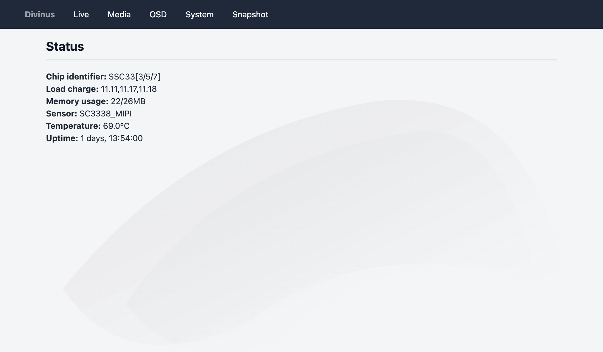

![OpenIPC logo][logo]

## Divinus
**_Divinus is a new open source, multi-platform streamer_**

[][telegram]

### Inner workings

This project strives to adopt a KISS "keep it simple, stupid!" structure while being as portable as can be.

Compared to most streamer software solutions available to this day, it attaches to the application-specific peripherals of a system-on-a-chip using an easy to understand HAL platform (hardware abstraction layer) proper to each chip series it supports.

Since it is using runtime dynamic linking, its executable remains particularly compact and can be run on a multitude of environments, including in a tethered context (e.g. running from a temporary filesystem on read-only systems).

In spite of these design choices, Divinus boasts numerous features that cater to a wide range of uses you will be able to make of it.

  

### Supported hardware and features

| SoC Family              | Audio Stream | JPEG Snapshot | fMP4 Stream | RTSP Stream | On-Screen Display* |
|-------------------------|:------------:|:-------------:|:-----------:|:-----------:|:------------------:|
| AK3918                  | ↻            | ↻            | ↻           | ↻           | ↻                 |
| CV181x[^1]              | ↻            | ↻            | ↻           | ↻           | ↻                 |
| FH885xV200[^2]          | ↻            | ✔️           | ✔️          | ✔️          | ✔️                |
| GM813x[^3]              | ✔️           | ✔️           | ✔️          | ✔️          | ✔️                |
| Hi3516AV100[^4]         | ✔️           | ✔️           | ✔️          | ✔️          | ✔️                |
| Hi3516CV100[^5]         | ↻            | ↻            | ✔️          | ✔️          | ✔️                |
| Hi3516CV200[^6]         | ✔️           | ✔️           | ✔️          | ✔️          | ✔️                |
| Hi3516CV300[^7]         | ✔️           | ✔️           | ✔️          | ✔️          | ✔️                |
| Hi3516CV500[^8]         | ✔️           | ✔️           | ✔️          | ✔️          | ✔️                |
| Hi3516EV200[^9]         | ✔️           | ✔️           | ✔️          | ✔️          | ✔️                |
| GK7205V200[^10]          | ✔️           | ✔️           | ✔️          | ✔️          | ✔️                |
| Hi3519V100[^11]         | ✔️           | ✔️           | ✔️          | ✔️          | ✔️                |
| Hi3519AV100             | ✔️           | ✔️           | ✔️          | ✔️          | ✔️                |
| Hi3559AV100             | ✔️           | ✔️           | ✔️          | ✔️          | ✔️                |
| RV11xx[^12]             | ↻            | ✔️           | ✔️          | ✔️          | ↻                 |
| T31 series              | ✔️           | ✔️           | ✔️          | ✔️          | ✔️                |
| infinity3[^13]          | ↻            | ↻            | ↻           | ↻           | ↻                 |
| infinity6[^14]          | ✔️           | ✔️           | ✔️          | ✔️          | ✔️                |
| infinity6b0[^15]        | ✔️           | ✔️           | ✔️          | ✔️          | ✔️                |
| infinity6e[^16]         | ✔️           | ✔️           | ✔️          | ✔️          | ✔️                |
| infinity6c[^17]         | ✔️           | ✔️           | ✔️          | ✔️          | ✔️                |
| mercury6[^18]           | ✔️           | ✔️           | ✔️          | ✔️          | ✔️                |
| sun8iw21p1[^19]         | ↻            | ↻            | ↻           | ↻           | ↻                 |

_✔️ - supported, ↻ - in development, ✗ - unsupported, ⁿ/ₐ - not supported by hardware_

_* At the moment, text, RGB or bitfield bitmaps and PNG overlays are handled, more matricial formats and covers are to follow_

[^1]: CV181x\[C/H\], SG200\[0/2\]
[^2]: FH885\[2/6/8\]V200
[^3]: GM813\[5/6/8\]\(S\)
[^4]: Hi3516AV100 and Hi3516DV100
[^5]: Hi3516CV100, Hi3518AV100, Hi3518CV100 and Hi3518EV100
[^6]: Hi3516CV200 and Hi3518EV20\[0/1\]
[^7]: Hi3516CV300 and Hi3516EV100
[^8]: Hi3516AV300, Hi3516CV500 and Hi3516DV300
[^9]: Hi3516DV200, Hi3516EV200/300 and Hi3518EV300
[^10]: GK7202V300, GK7205V200/300 and GK7605V100
[^11]: Hi3516AV200 and Hi3519V101
[^12]: RV110\[3/7/8/9\], RV1106\(G2/G3\) and RV1126
[^13]: MSC313E, MSC316\[DC/Q\] and MSC318
[^14]: SSC323, SSC325\(D/DE\) and SSC327\(D/DE/Q\)
[^15]: SSC33\[3/5/7\]\(DE\)
[^16]: SSC30K\[D/Q\], SSC336\[D/Q\], SSC338\[D/G/Q\] and SSC339G
[^17]: SSC377\(D/DE/QE\) and SSC378\[DE/QE\]
[^18]: SSC359G
[^19]: V851S\(E\) and V853

### Documentation

- [Configuration](doc/config.md) - _doc/config.md_
- [Endpoints](doc/endpoints.md) - _doc/endpoints.md_
- [Overlays](doc/overlays.md) - _doc/overlays.md_

### Roadmap

- [ ] Audio source, input gain and output volume
- [ ] ONVIF write support, enhanced compatiblity
- [ ] Motors and PTZ control
- [ ] Lens correction profiles
- [ ] Motion detection
- [ ] Alternative audio codecs

### Disclaimer

This software is provided AS IS and for research purposes only. OpenIPC shall not be liable for any loss or damage caused by the use of these files or the use of, or reliance upon, any information contained within this project.

### Technical support and donations

Please **_[support our project](https://openipc.org/support-open-source)_** with donations or orders for development or maintenance. Thank you!

[firmware]: https://github.com/openipc/firmware
[logo]: https://raw.githubusercontent.com/OpenIPC/.github/refs/heads/main/assets/openipc-logo-black.svg
[mit]: https://opensource.org/license/mit
[opencollective]: https://opencollective.com/openipc
[paypal]: https://www.paypal.com/donate/?hosted_button_id=C6F7UJLA58MBS
[project]: https://github.com/openipc
[telegram]: https://openipc.org/our-channels
[website]: https://openipc.org
[wiki]: https://github.com/openipc/wiki
